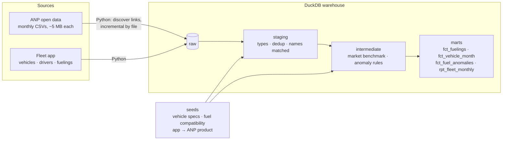

# Fleet fuel analytics with dbt — real ANP market prices vs. what the fleet actually paid

[](https://github.com/eduardohaas/fleet-fuel-analytics-dbt/actions/workflows/dbt.yml)
[](https://eduardohaas.github.io/fleet-fuel-analytics-dbt/)

> **Resumo em português** — Custo de combustível de uma frota de 36 veículos no RS comparado com os **preços reais da ANP** (107 mil preços coletados em postos, jan/2025 a out/2026, atualizados toda semana). Cinco regras de anomalia rodam sobre o que os motoristas lançam no app da frota.
> - **A alta do diesel de mar/2026 custou R$ 63 mil por mês à frota:** o custo por km foi de R$ 1,83 para R$ 2,05 (+11,6%).
> - **R$ 120 mil pagos acima do mercado, 61% em um único posto**, que cobrava em média 12% acima da mediana da cidade.
> - **Um caminhão consumiu 6.828 litros a mais do que deveria** em 4 meses (cerca de R$ 46 mil), e a regra pegou já no primeiro mês.
> - Carga incremental que descobre os arquivos da ANP sozinha (os nomes mudam sem aviso e falta o mês de abril/2026), modelos incrementais no dbt, 36 testes e CI com cache.
>
> Preços da ANP reais; frota e postos fictícios. Documentação técnica em inglês abaixo.

Fuel is the largest variable cost of a logistics company, and the fleet manager has three questions every month: **what does each kilometer cost, are we paying market price, and is any fuel disappearing?**

This project answers them for a 36-vehicle fleet in Rio Grande do Sul, Brazil. It benchmarks every fueling against **real retail prices collected by ANP** (the National Petroleum Agency, 107,500 station prices from Jan/2025 to Oct/2026) and runs five anomaly rules over what drivers log in the fleet app.

The ANP data is real and refreshed weekly. The fleet is synthetic, built on top of the real prices, with stations that are fictional on purpose.

## What the model shows (Jan/2025 – Oct/2026)

- **The March 2026 diesel jump cost the fleet R$ 63k a month.** ANP's Diesel S10 median in RS went from R$ 6.23 to R$ 6.89 per liter on average; fleet cost per km went from **R$ 1.83 to R$ 2.05 (+11.6%)**.
- **R$ 120k paid above market, 61% of it at one station.** "Posto Rota Pelotas 2" charged on average 12% above the city's ANP median, 359 times.
- **One truck burned 6,828 liters it shouldn't have.** SUL1H07 dropped from 2.5 to ~1.7 km/l between May and August 2026 (≈ R$ 46k), then went back to normal. The rule flagged it in the first month.

| Vehicle class | Fuel cost per km |
| --- | ---: |
| Heavy truck | R$ 2.61 |
| Light truck | R$ 1.19 |
| Van | R$ 0.72 |
| Car | R$ 0.56 |

What the fleet manager gets in `fct_fuel_anomalies`:

| Rule | Plate | Date | City | Reason |
| --- | --- | --- | --- | --- |
| price_above_market | SUL1V28 | 2026-10-28 | Pelotas | paid 8.33 vs 7.39 city median (12.7%) |
| over_tank | SUL1C36 | 2026-10-30 | Santa Cruz do Sul | 59.83 L in a 50 L tank |
| odometer_regression | SUL1H11 | 2026-10-22 | Novo Hamburgo | odometer 312101 km is below a previous reading |
| wrong_fuel | SUL1H06 | 2026-07-02 | Santa Cruz do Sul | GASOLINA logged for a heavy truck |
| low_efficiency | SUL1C36 | 2026-10-30 | Santa Cruz do Sul | 8.49 km/l vs 11.5 benchmark |

## Architecture



## Real-world data problems handled

**ANP open data**
- **File names change without notice.** 2026 alone has `01-dados-abertos-precos-...`, `02-cados-abertos-...` (sic), `06-dados-abertos-precos-2026-06-...` and `10-diesel-gnv.csv`. The loader reads ANP's page, discovers the links and infers year and month from whatever pattern it finds. Nothing is hardcoded.
- **Months go missing.** There is no April 2026 file. `int_market_prices` falls back to the city's last known month, then to the state median, and records which fallback was used (`benchmark_source`).
- **Text everywhere.** `DD/MM/YYYY` dates, decimal commas, upper-case city names without accents. Staging types and normalizes them; city names from the fleet app are matched with `upper(strip_accents())`.
- **Large and slow.** 42 files from a slow government server. Loading is incremental by file (a manifest table), and CI keeps the downloaded files in cache, so a weekly run only fetches what ANP published since the last one.

**Fleet app**
- **Double submissions.** The driver taps "send" twice and the app creates a new id, so dedup is by content (vehicle, time, liters, amount), not by id.
- **Odometer typos.** Distance is measured against the *highest previous* reading, so one typo is flagged without corrupting the next fueling's km/l (a plain `lag()` would). There is a unit test for exactly that.

## Anomaly rules

Thresholds are dbt vars, so they can be tuned without touching SQL:

| Rule | Fires when | Var |
| --- | --- | --- |
| `over_tank` | liters > tank capacity × 1.05 (jerrycans) | `tank_tolerance` |
| `odometer_regression` | odometer below a previous reading | — |
| `wrong_fuel` | product not allowed for the vehicle (seed `fuel_compatibility`) | — |
| `price_above_market` | price > ANP city median × 1.08 | `price_premium_threshold` |
| `low_efficiency` | km/l < 75% of the model's benchmark (seed `vehicle_models`) | `efficiency_floor` |

```bash
dbt build --vars '{price_premium_threshold: 0.05}'   # stricter procurement policy
```

## Tests

36 tests run on every push as part of `dbt build`:

- **Unit test** — [`anomaly_rules_flag_the_right_fuelings`](models/intermediate/_intermediate__models.yml): five fixed fuelings, one per situation, with exact expected flags and distances. Swapping the odometer logic for a plain `lag()` makes it fail.
- **Reconciliation** — [`assert_vehicle_month_reconciles_to_fuelings`](tests/assert_vehicle_month_reconciles_to_fuelings.sql): the vehicle-month view adds up to exactly what was paid at the pump.
- **Dedup** — [`assert_no_double_submissions_left`](tests/assert_no_double_submissions_left.sql).
- **Data tests** — every fueling has a market benchmark, every vehicle has specs, accepted values for ANP products and anomaly rules, accepted price ranges.
- **Source freshness** — warns if no new ANP file was loaded in 45 days.

## Incremental models

- `stg_anp__fuel_prices` — append-only by source file: a monthly file is processed once.
- `fct_fuelings` — `delete+insert` on `fueling_id` with a 7-day lookback for late submissions and corrections.

## CI and docs

GitHub Actions ([`dbt.yml`](.github/workflows/dbt.yml)) runs on every push and every Monday: restore ANP cache → ingest → freshness → `dbt build` → publish the dbt docs (lineage graph included) to **[eduardohaas.github.io/fleet-fuel-analytics-dbt](https://eduardohaas.github.io/fleet-fuel-analytics-dbt/)**.

## Run it locally

Needs Python 3.11. No cloud account, no credentials, no cost. The first ANP download takes a few minutes.

```bash
make setup   # venv + dependencies + dbt packages
make all     # download ANP prices, generate the fleet extract, dbt build
make docs    # open the docs with the lineage graph
```

## Stack

dbt Core 1.12 · DuckDB · Python (requests, duckdb) · dbt_utils · GitHub Actions (with cache) · GitHub Pages

Source: [ANP — Série histórica de preços de combustíveis](https://www.gov.br/anp/pt-br/centrais-de-conteudo/dados-abertos/serie-historica-de-precos-de-combustiveis) (open data).

---

Built by [Eduardo Haas](https://github.com/eduardohaas) · [LinkedIn](https://www.linkedin.com/in/eduardo-haas-ab784b127/)
